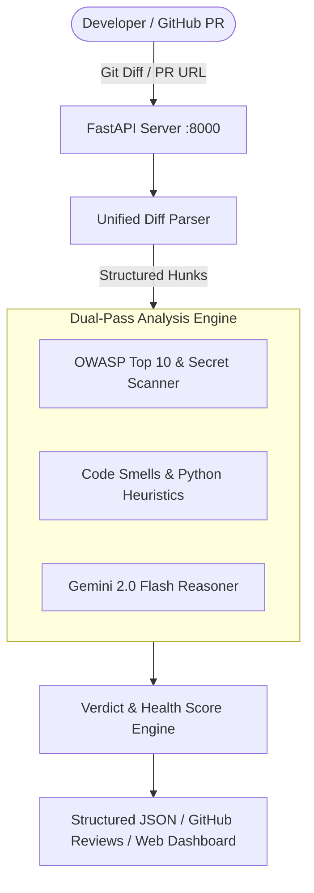

# 🤖 AI Code Review Bot

[](https://www.python.org/downloads/)
[](https://fastapi.tiangolo.com)
[](https://ai.google.dev/)
[](https://www.docker.com/)
[](tests/)
[](LICENSE)

An intelligent, production-ready **AI Code Review Bot and Security Auditing Engine** that automatically inspects Git diffs, analyzes GitHub Pull Requests, detects OWASP Top 10 vulnerabilities and hardcoded secrets, computes a **0–100 Code Health Score**, and generates line-by-line review comments with **1-click GitHub ````suggestion` replacement blocks**.

---

## 🌟 Key Features

- **🛡️ Deterministic OWASP & Secret Scanner:** Catches AWS access keys, GitHub tokens, OpenAI credentials, SQL injection, `eval`/RCE, `pickle` deserialization, and command injection before code reaches production.
- **🧠 Multi-Pass AI Review Engine:** Hybrid pipeline combining lightning-fast deterministic pattern matching with Gemini 2.0 Flash reasoning for subtle logic bugs, anti-patterns, and architecture smells.
- **💡 1-Click Inline Fixes:** Generates standardized GitHub diff suggestion blocks:
  ````suggestion
  cursor.execute("SELECT * FROM users WHERE id = %s", (user_id,))
  ````
- **📊 Code Health Score & PR Verdicts:** Computes an objective 0–100 quality score and assigns automated verdicts: `APPROVE`, `COMMENT`, or `REQUEST_CHANGES`.
- **🔗 GitHub PR & Webhook Integration:** Directly fetches diffs from public or private GitHub PR URLs (`https://github.com/owner/repo/pull/123`) and posts inline review comments back to the PR.
- **🎨 Interactive Dark-Mode Playground:** Built with Tailwind CSS, featuring preset vulnerability diffs, real-time category filtering, clipboard copy, and Markdown/JSON report export.

---

## 🏗️ Architecture



---

## 🚀 Quick Start

### 1. Clone & Set Up Environment

```bash
git clone https://github.com/jayshreeganesh/ai-code-reviewer.git
cd ai-code-reviewer

# Create virtual environment
python -m venv venv

# Activate virtual environment
# Windows:
.\venv\Scripts\Activate.ps1
# Linux/macOS:
source venv/bin/activate

# Install dependencies
pip install -r requirements.txt
```

### 2. Configure Environment Variables

Create a `.env` file in the root directory:

```env
GEMINI_API_KEY="your-gemini-api-key"
GITHUB_TOKEN="your-github-personal-access-token"  # Optional, for posting reviews
PORT=8000
```

### 3. Run the Development Server

```bash
uvicorn app.main:app --reload --port 8000
```

Open your browser at:
- **Interactive Web UI:** [http://localhost:8000/](http://localhost:8000/)
- **Swagger API Docs:** [http://localhost:8000/docs](http://localhost:8000/docs)
- **Health Check:** [http://localhost:8000/health](http://localhost:8000/health)

---

## 🐳 Docker Deployment

### Run Locally with Docker

```bash
# Build the container image
docker build -t ai-code-reviewer .

# Run container on port 8000
docker run -p 8000:8000 -e GEMINI_API_KEY="your-key" ai-code-reviewer
```

---

## 📡 API Reference

### 1. Review Raw Diff or Code Snippet
- **`POST /api/v1/review/diff`**

**Request:**
```json
{
  "diff": "diff --git a/app.py b/app.py\n@@ -1,3 +1,3 @@\n- query = 'SELECT * FROM users'\n+ query = f'SELECT * FROM users WHERE id = {user_id}'",
  "enable_security_scan": true,
  "enable_ai_review": true
}
```

**Response:**
```json
{
  "summary": {
    "health_score": 40,
    "verdict": "REQUEST_CHANGES",
    "critical_count": 1,
    "warning_count": 0,
    "info_count": 0,
    "overview": "Detected 1 critical security vulnerability."
  },
  "findings": [
    {
      "file_path": "app.py",
      "line_number": 2,
      "category": "security",
      "severity": "CRITICAL",
      "title": "SQL Injection (Formatted Query)",
      "description": "User input directly interpolated into SQL query string.",
      "suggested_fix": "query = \"SELECT * FROM users WHERE id = %s\"\ncursor.execute(query, (user_id,))"
    }
  ],
  "files_changed": ["app.py"],
  "analyzed_at": "2026-11-10T21:30:00Z"
}
```

### 2. Review GitHub Pull Request
- **`POST /api/v1/review/pr`**

```json
{
  "pr_url": "https://github.com/owner/repository/pull/42",
  "post_to_github": false
}
```

---

## 🧪 Running Automated Tests

Run the complete test suite:

```bash
pytest tests -v
```

---

## 📄 License

Distributed under the MIT License. See `LICENSE` for more information.
